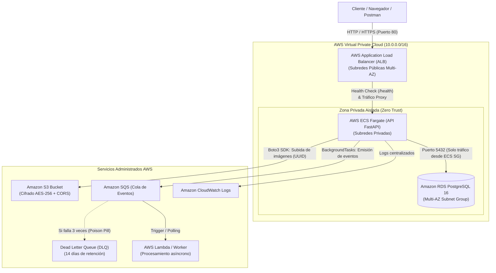

# Inventory Cloud API 🚀

[](https://github.com/sebcorva/Inventary-Cloud-API/actions/workflows/ci.yml)


RESTful API de alto rendimiento para la gestión de inventario, catálogo de productos y almacenamiento multimedia en la nube. Diseñada bajo principios **Cloud-Native**, arquitectura desacoplada orientada a eventos (**Event-Driven Architecture**), seguridad **Zero-Trust** e **Infraestructura como Código (IaC)** reproducible con Terraform.

---

## 🏛️ Arquitectura del Sistema en la Nube



---

## 🌟 Decisiones de Diseño

### 1. Procesamiento Asíncrono y Desacoplado (SQS + DLQ)
En lugar de procesar tareas pesadas (redimensionamiento de imágenes, alertas por correo) en el hilo HTTP bloqueante:
- La API responde inmediatamente `201 Created` al usuario (< 30ms).
- Mediante `BackgroundTasks` de FastAPI y `boto3`, se emite un evento estructurado (*Event Envelope*) a **Amazon SQS**.
- **Resiliencia con Dead Letter Queue (DLQ):** Si un worker falla 3 veces consecutivas al procesar un mensaje (`maxReceiveCount = 3`), SQS lo traslada a la DLQ para análisis sin perder datos ni bloquear la cola principal.

### 2. Principios 12-Factor App y Gestión Segura de Credenciales
- **Cero secretos en código:** La configuración se valida en arranque mediante **Pydantic Settings v2**.
- **Paridad de Entornos:** En desarrollo local, Pydantic toma las variables de `.env`. En AWS, el contenedor Docker corre **sin contraseñas fijas**, asumiendo un **IAM Task Role** con políticas de menor privilegio (*Least Privilege*) para acceder a S3 y SQS.

### 3. Redes y Seguridad Zero-Trust
- **Aislamiento en Subredes Privadas:** La base de datos PostgreSQL en RDS y los contenedores ECS residen en subredes privadas sin IP pública.
- **Security Group Chaining:** El cortafuegos de PostgreSQL solo acepta tráfico en el puerto 5432 proveniente del Security Group específico del clúster ECS.

### 4. Infraestructura como Código (IaC con Terraform)
Toda la infraestructura de AWS está versionada y modularizada en la carpeta `terraform/`:
- **`modules/vpc`:** VPC Multi-AZ (`us-east-1a`, `us-east-1b`), subredes públicas/privadas y tablas de enrutamiento.
- **`modules/s3_sqs`:** Bucket multimedia con cifrado SSE-S3 y cola SQS vinculada a DLQ.
- **`modules/rds`:** Instancia PostgreSQL administrada con auto-escalado de almacenamiento (`gp3`).
- **`modules/ecs`:** Clúster ECS, Fargate Task Definition, Application Load Balancer y CloudWatch Logs.

### 5. Calidad Continua y Pipeline CI/CD
- **Pytest:** 19 pruebas automatizadas (unitarias y de integración) utilizando base de datos SQLite en memoria ultra-rápida y simulación de AWS (`unittest.mock`).
- **GitHub Actions:** Pipeline automatizado en `.github/workflows/ci.yml` que en cada push o Pull Request ejecuta la suite de pruebas y valida la construcción del contenedor Docker multi-stage.

---

## 🛠️ Tech Stack

| Categoría | Tecnología | Uso en el Proyecto |
| :--- | :--- | :--- |
| **Lenguaje** | Python 3.12 | Tipado estricto, concurrencia asíncrona |
| **Framework Web** | FastAPI 0.115 + Uvicorn | Endpoints REST, OpenAPI/Swagger UI interactivo |
| **ORM & DB** | PostgreSQL 16 + SQLAlchemy 2.0 | Psycopg v3, transacciones ACID |
| **Migraciones** | Alembic | Versionado del esquema de base de datos |
| **Seguridad** | OAuth2 + JWT (PyJWT) + Passlib | Autenticación Bearer, hashing con Bcrypt |
| **Almacenamiento** | Amazon S3 + Boto3 | Almacenamiento multimedia con claves únicas UUID |
| **Mensajería** | Amazon SQS | Buffer de eventos asíncronos y desacoplamiento |
| **Contenedores** | Docker & Docker Compose | Contenedores multi-stage con usuario no-root |
| **IaC** | Terraform >= 1.5 | Aprovisionamiento automatizado de infraestructura AWS |
| **CI/CD** | GitHub Actions | Pipeline automatizado de testing y build de imágenes |

---

## 📡 Matriz de Endpoints y Eventos

### Autenticación (`/auth`)
| Método | Endpoint | Descripción | Auth Requerida |
| :--- | :--- | :--- | :---: |
| `POST` | `/auth/register` | Registra un nuevo usuario con contraseña hasheada | No |
| `POST` | `/auth/login` | Inicia sesión (OAuth2 Form) y entrega token JWT Bearer | No |

### Productos (`/products`)
| Método | Endpoint | Descripción | Evento Emitido a SQS | Auth Requerida |
| :--- | :--- | :--- | :---: | :---: |
| `GET` | `/products` | Lista catálogo de productos con paginación (`skip`, `limit`) | - | No |
| `GET` | `/products/{id}` | Obtiene el detalle de un producto específico | - | No |
| `POST` | `/products` | Crea un producto asociado al usuario autenticado | `PRODUCT_CREATED` | **Sí (Bearer)** |
| `POST` | `/products/{id}/image`| Sube imagen a AWS S3 (valida tipos MIME) | `PRODUCT_IMAGE_UPLOADED` | **Sí (Propietario)** |
| `PUT` | `/products/{id}` | Actualiza producto (emite alerta si stock <= 5) | `LOW_STOCK_ALERT` | **Sí (Propietario)** |
| `DELETE` | `/products/{id}` | Elimina producto y remueve su imagen en S3 | - | **Sí (Propietario)** |

### Sistema (`/health`)
| Método | Endpoint | Descripción | Auth Requerida |
| :--- | :--- | :--- | :---: |
| `GET` | `/health` | Health check para balanceadores AWS ALB (`200 OK`) | No |

---

## 🚀 Guía Rápida de Ejecución Local

Para una guía detallada paso a paso sobre cómo configurar credenciales de AWS S3, levantar los contenedores con Docker y realizar pruebas en Postman o Swagger UI, consulta la **[Guía de Ejecución Local (LOCAL_SETUP.md)](LOCAL_SETUP.md)**.

### Inicio Rápido (3 Comandos):

```bash
# 1. Clonar el repositorio
git clone https://github.com/sebcorva/Inventary-Cloud-API.git
cd Inventary-Cloud-API

# 2. Configurar variables de entorno
cp .env.example .env

# 3. Levantar API y PostgreSQL con Docker Compose
docker compose up --build
```

- **Documentación Interactiva (Swagger UI):** [http://localhost:8000/docs](http://localhost:8000/docs)
- **Documentación Alternativa (ReDoc):** [http://localhost:8000/redoc](http://localhost:8000/redoc)
- **Healthcheck & Métricas:** [http://localhost:8000/health](http://localhost:8000/health)
- **Colección de Postman:** Importa [`docs/postman/Inventory_Cloud_API.postman_collection.json`](docs/postman/Inventory_Cloud_API.postman_collection.json) con token JWT automático para pruebas en 1 clic.

---

## 🧪 Ejecución de Pruebas Automatizadas

El proyecto incluye **20 pruebas automáticas** que validan el 100% de los endpoints, autenticación, headers de observabilidad (`X-Request-ID`), control de acceso y procesamiento de eventos sin requerir conexión a internet ni generar cargos en AWS:

```bash
# Ejecutar la suite completa con Pytest
pytest -v
```

---

## 🏗️ Despliegue de Infraestructura con Terraform

Para aprovisionar la infraestructura completa en AWS:

```bash
cd terraform/environments/dev

# 1. Inicializar proveedores de Terraform
terraform init

# 2. Previsualizar recursos a crear (Plan)
terraform plan

# 3. Aprovisionar infraestructura en AWS
terraform apply

# 4. Destruir infraestructura para evitar costos cuando no se use
terraform destroy
```

---

## 👤 Autor

**Sebastián Corvalán**
- **GitHub:** [@sebcorva](https://github.com/sebcorva)
- **Enfoque:** Backend Engineering & Cloud Computing (AWS / Python / DevOps)
