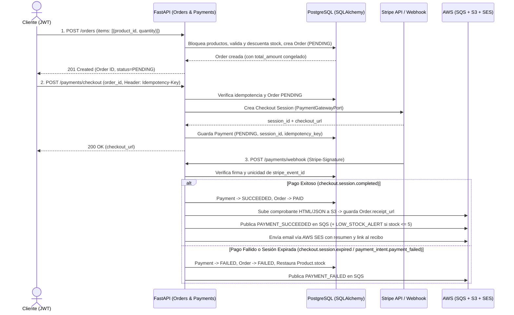

# PRD: Control de Acceso por Roles (RBAC), Órdenes y Pasarela de Pagos Cloud-Native

## 1. Problema y Objetivo
Actualmente, `inventary-cloud-api` gestiona productos asociándolos a un `owner_id` individual y carece de un flujo transaccional de compra y cobro.
El objetivo de esta especificación es evolucionar la API hacia una arquitectura de **E-Commerce Cloud-Native** real mediante:
1. **RBAC de Catálogo (`is_admin`):** Eliminar `owner_id` de `Product`. Solo los administradores (`is_admin=True`) pueden administrar el catálogo; cualquier usuario autenticado puede comprar.
2. **Gestión de Órdenes y Reserva Atómica de Stock (`Order` + `OrderItem`):** Permitir compras de múltiples productos congelando el precio histórico y reservando stock de forma segura ante concurrencia.
3. **Pasarela de Pagos Desacoplada con Stripe (`PaymentGatewayPort`):** Integrar Stripe Checkout con protección de idempotencia y verificación criptográfica de Webhooks.
4. **Flujo Post-Pago Cloud (AWS SQS + S3 + SES):** Al confirmarse un pago, emitir eventos a SQS, subir el comprobante (`Receipt`) a S3 y enviar correo de confirmación con AWS SES (con fallback a consola en desarrollo local).

---

## 2. Arquitectura y Flujo de Datos

---

## 3. Modelos de Datos y Contratos

### 3.1 Cambios en Modelos Existentes
* **`User` (`app/models/user.py`):**
  * Nuevo campo: `is_admin: Column(Boolean, default=False, nullable=False)`
  * Seguridad en `UserCreate` (`POST /auth/register`): **No** incluye `is_admin` (siempre se registra como `False`).
* **`Product` (`app/models/product.py`):**
  * Se **elimina** `owner_id` y la relación `owner`.
  * Los endpoints de escritura (`POST /products`, `PUT /products/{id}`, `DELETE /products/{id}`, `POST /products/{id}/image`) requieren la dependencia `get_current_admin_user`.

### 3.2 Estrategia de Creación de Administradores (Patrón Híbrido 12-Factor)
1. **Auto-Bootstrap en Inicialización / CLI:**
   * En `app/config.py`: Variables opcionales `FIRST_SUPERUSER_EMAIL`, `FIRST_SUPERUSER_USERNAME` y `FIRST_SUPERUSER_PASSWORD`.
   * Función `ensure_initial_admin(db: Session)` ejecutable en el arranque (`lifespan`) o vía CLI (`python -m app.cli create-admin`) que crea o promueve al superusuario inicial de forma idempotente.
2. **Promoción vía Endpoint Protegido:**
   * `PATCH /users/{user_id}/role` (Protegido por `get_current_admin_user`): Recibe `{"is_admin": true | false}` y actualiza el rol del usuario objetivo.

### 3.3 Nuevas Entidades (`Order`, `OrderItem`, `Payment`)
* **`Order` (`app/models/order.py`):**
  * `id`: `Integer`, PK
  * `user_id`: `Integer`, FK(`users.id`), nullable=False, index=True
  * `status`: `String`, default=`"PENDING"` (`PENDING`, `PAID`, `FAILED`, `CANCELLED`)
  * `total_amount`: `Numeric(10, 2)` / `Float`, nullable=False
  * `currency`: `String(3)`, default=`"usd"`
  * `receipt_url`: `String`, nullable=True (URL en S3 tras confirmación)
  * `created_at`: `DateTime(timezone=True)`, default UTC now
  * `items`: `relationship("OrderItem", back_populates="order", cascade="all, delete-orphan")`
* **`OrderItem` (`app/models/order.py`):**
  * `id`: `Integer`, PK
  * `order_id`: `Integer`, FK(`orders.id`), nullable=False
  * `product_id`: `Integer`, FK(`products.id`), nullable=False
  * `quantity`: `Integer`, nullable=False (`> 0`)
  * `unit_price`: `Numeric(10, 2)` / `Float`, nullable=False (congelado desde `Product.price` al crear la orden)
* **`Payment` (`app/models/payment.py`):**
  * `id`: `Integer`, PK
  * `order_id`: `Integer`, FK(`orders.id`), nullable=False, index=True
  * `provider`: `String`, default=`"stripe"`
  * `stripe_session_id`: `String`, unique=True, index=True, nullable=True
  * `stripe_event_id`: `String`, unique=True, index=True, nullable=True (evita reprocesar el mismo webhook)
  * `idempotency_key`: `String`, unique=True, index=True, nullable=False
  * `amount`: `Numeric(10, 2)` / `Float`, nullable=False
  * `status`: `String`, default=`"PENDING"` (`PENDING`, `SUCCEEDED`, `FAILED`)
  * `created_at`: `DateTime(timezone=True)`, default UTC now

### 3.4 Endpoints Nuevos y Modificados
| Método | Endpoint | Permiso | Descripción |
| :--- | :--- | :--- | :--- |
| `PATCH` | `/users/{user_id}/role` | `Admin` | Promueve o revoca rol de administrador (`is_admin`). |
| `POST` | `/orders` | `User (JWT)` | Crea orden, valida y reserva stock atómicamente. Emite `ORDER_CREATED` a SQS. |
| `GET` | `/orders` | `User (JWT)` | Lista las órdenes del usuario autenticado (con sus ítems y `receipt_url`). |
| `GET` | `/orders/{order_id}` | `User (Dueño) o Admin` | Obtiene detalle de una orden específica. |
| `POST` | `/payments/checkout` | `User (Dueño)` | Requiere header `Idempotency-Key`. Inicia sesión en Stripe y devuelve `checkout_url`. |
| `POST` | `/payments/webhook` | `Público (Firma Stripe)` | Verifica `Stripe-Signature`, procesa éxito/fallo de forma idempotente. |

---

## 4. Casos Borde y Modos de Fallo
1. **Stock Insuficiente o Concurrencia:**
   * Al ejecutar `POST /orders`, se consulta cada producto con bloqueo de fila (`with_for_update()`). Si algún producto no existe (`404`) o tiene `stock < quantity` (`409 Conflict`), toda la transacción hace rollback sin descontar ningún ítem.
2. **Idempotencia en Checkout:**
   * Si el cliente envía `POST /payments/checkout` con un `Idempotency-Key` que ya existe para esa orden, se retorna el `Payment` y `checkout_url` previamente creados (`200 OK`) sin volver a llamar a Stripe.
   * Si la orden ya está `PAID`, retorna `409 Conflict`.
3. **Idempotencia en Webhooks y Liberación de Stock:**
   * Si llega un webhook con un `stripe_event_id` ya registrado o para una orden que ya está `PAID`/`FAILED`, se devuelve `200 OK` ignorando el duplicado.
   * Si el evento es de fallo/expiración (`checkout.session.expired` o `payment_intent.payment_failed`) y la orden estaba `PENDING`, pasa a `FAILED` y se devuelve la cantidad (`quantity`) al `Product.stock`.
4. **Resiliencia en Servicios Cloud (S3, SQS, SES):**
   * El envío de correo por AWS SES (`ses_service.py`) se ejecuta en `BackgroundTasks`. Si las credenciales de AWS no están configuradas en local, registra el correo formateado en los logs sin tumbar el webhook.

---

## 5. Estrategia de Testing (TDD en Fronteras Públicas)
* Todos los slices se implementarán usando **Red-Green-Refactor** con `pytest` y `TestClient` en `/tests/`.
* Se inyectará un adaptador limpio para Stripe (`PaymentGatewayPort`) y mocks para `s3_service`, `sqs_service` y `ses_service` en `conftest.py`.

---

## 6. Fuera de Alcance (Out of Scope)
* Reembolsos parciales (`partial refunds`) o disputas/chargebacks.
* Suscripciones recurrentes.
* Múltiples monedas dinámicas por ítem en una misma orden (todas las órdenes operan en la moneda base configurada, ej. `usd`).
